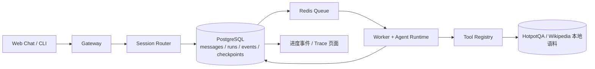

先把参照对象说清：**我前面实际建议的是 DeerFlow 风格的 Deep Research Agent，不是 OpenClaw 仿制版。**把两个项目混着说，是我前面没定清楚。

如果现在选 OpenClaw 作参照，我建议项目正式定义为：

# MiniClaw：带可恢复运行时的个人 Agent Gateway

交付目标是一个能运行的系统：用户从 Web Chat 或 CLI 发来研究问题；Gateway 把消息路由到正确的 Session；Agent 调用工具查资料、生成有引用的答案；任务中断后能恢复；用户可以查看执行轨迹和评测结果。

这里模仿的是 **OpenClaw 的系统结构和交互流程**，不是复制它的代码，也不是 fork 后换个界面。OpenClaw 的公开文档把 Gateway 定为消息入口、Session 路由和连接管理的中心；Agent Runtime 负责组装 Context、连接 Tools 和管理 Session；Skills 从 `SKILL.md` 等目录加载；同一 Session 的运行会排队，避免并发写坏对话状态。[Gateway 架构](https://github.com/openclaw/openclaw/blob/main/docs/concepts/architecture.md)、[Agent Runtime](https://github.com/openclaw/openclaw/blob/main/docs/concepts/agent.md)、[Agent Loop 与并发](https://github.com/openclaw/openclaw/blob/main/docs/concepts/agent-loop.md)、[Skills](https://github.com/openclaw/openclaw/blob/main/docs/tools/creating-skills.md)

## 模仿哪些部分

| OpenClaw 的部分 | MiniClaw 复刻范围 |
|---|---|
| Gateway | 单一服务接 Web Chat 和 CLI，负责认证、消息校验、Session 路由和事件推送 |
| Session | 同一会话串行执行；保存消息、运行状态、检查点和工具记录 |
| Agent Runtime | 实现有步数和 token 上限的模型—工具循环、Context 组装和工具结果回传 |
| Tools / Skills | 工具用有类型的接口注册；Skill 用带版本的 `SKILL.md` 描述何时使用哪些工具 |
| 长任务运行 | 后台执行、查看进度、取消、审批暂停、进程重启后恢复 |
| 控制界面 | Web 页面显示对话、运行状态、工具轨迹、引用和评测结果 |

**第一版不复刻** OpenClaw 的所有聊天平台连接器、手机节点、插件市场和桌面应用。那会让项目变成大量接线工作，评测不到 Agent Runtime。先做 Web Chat 和 CLI 两个入口，就能证明 Gateway 与 Session 路由。

## 场景和数据从哪里来

第一版的 Agent 场景定为**多跳资料研究**，例如先查“电影改编自哪本书”，再查“作者出生在哪个国家”，最后给出带出处的答案。这个任务不用你的广告、商品或公司数据。

评测使用公开的 HotpotQA：数据包含多跳问题、答案和支持事实，官方提供下载集和 Wikipedia 语料，许可为 CC BY-SA 4.0。这样答案和证据都有对照标准；工具超时、重复事件、Worker 重启则用可重复的故障注入场景测试。[HotpotQA 数据集](https://hotpotqa.github.io/)

## 运行链路



一条任务按这个顺序跑：

1. Gateway 接受消息，用 `channel + conversation_id + provider_message_id` 去重，然后解析 `agent_id` 和 `session_key`。
2. Session Router 为同一 Session 排队，只允许一个 Run 写入该 Session；不同 Session 可以并行。
3. Run 创建事务同时写入数据库和 Outbox。Outbox Dispatcher 再把任务送入 Redis，避免“数据库显示已创建、队列里却没有任务”的丢失窗口。
4. Worker 领取带租约的 Run，构造 Context，调用模型。模型只能返回最终答案或注册过的 Tool Call。
5. 服务端校验工具名称、参数 schema、权限、超时和预算，再执行工具。**权限由代码决定，不由 Prompt 决定。**
6. 工具返回后，系统保存工具结果、证据和下一检查点；把有明确 `tool_call_id` 的结果交回模型。
7. 最终答案通过引用校验器：每条事实引用的 `evidence_id` 必须存在于本 Run 实际取回的来源里；不满足就继续查或报告证据不足。

## 代码模块

```text
miniclaw/
  apps/
    gateway/                 # WebSocket/API、认证、会话路由
    worker/                  # 队列消费、Run 执行、恢复
    web/                     # 对话、进度、审批、Trace 页面
  packages/
    protocol/                # 请求/事件 schema、协议版本
    runtime/                 # Agent loop、planner、上下文组装
    sessions/                # Session key、并发锁、对话历史
    tools/                   # 工具注册、参数校验、权限、重试策略
    skills/                  # SKILL.md 加载、版本和允许工具
    persistence/              # Runs、Events、Checkpoints、Outbox
  skills/
    deep-research/SKILL.md
  evals/
    hotpotqa/                 # 固定样本、评分器、结果
    fault-injection/          # 超时、重启、重复事件
```

建议用 **TypeScript/Node** 实现 Gateway 和 Runtime，以便直接对照 OpenClaw 的实现语言；PostgreSQL 是 Run 和事件的事实来源，Redis 只负责排队唤醒 Worker。消息协议使用 Zod schema 验证。评测脚本可以用 Python，因为 HotpotQA 的答案和支持事实评分更容易复用现成数据处理工具。

## 状态和恢复怎么做

Run 状态限定为：

```text
queued → running → waiting_approval → running → succeeded
                  ↘ failed / cancelled
```

核心表：

```text
sessions(
  id, agent_id, session_key, version, active_run_id
)

runs(
  id, session_id, status, checkpoint_json,
  attempt, token_budget, deadline_at, version
)

run_events(
  run_id, seq, event_type, payload_json, created_at
)

tool_calls(
  id, run_id, tool_name, status,
  input_hash, result_json, attempt
)

evidence(
  id, run_id, document_id, source_url,
  snippet, snippet_hash, retrieved_at
)
```

`run_events` 是追加写入的轨迹，按 `(run_id, seq)` 排序；`checkpoint_json` 保存当前节点、已完成子问题、证据 ID 和剩余预算。Worker 每完成一个节点，就在同一事务里写入节点结果、事件和新检查点。

假设检索工具已经返回结果，Worker 却在写入数据库前崩溃。恢复时，Run 会看到这个工具调用还停在 `started`。由于本地语料检索是只读操作，可以重新检索；已完成并保存的节点则不再执行。设计上不宣称外部工具“恰好执行一次”：只读工具允许安全重试；有副作用的工具必须有幂等键。OpenClaw 也对 Session 运行做串行化，并用 `activeWriterRunId` 阻止旧 Run 覆盖新结果，可把这个并发保护思路复刻进来。[OpenClaw Agent Loop](https://github.com/openclaw/openclaw/blob/main/docs/concepts/agent-loop.md)

## Agent Loop 和 Context

```text
输入问题
 → Planner 产出最多 3 个子问题
 → 并行调用 search_passages(query, top_k)
 → 证据去重、打分、存储
 → Synthesis 生成带 evidence_id 的 claims
 → Citation Validator 检查引用
 → 信息不足则再查一次，达到预算则停止并说明缺口
```

每个 Tool 使用固定 schema，例如：

```ts
type SearchPassagesInput = {
  query: string;
  topK: number;       // 1..8
  corpusVersion: string;
};

type Evidence = {
  evidenceId: string;
  documentId: string;
  title: string;
  passage: string;
  supportingSentenceIds: string[];
};
```

Context Builder 不把完整历史无限塞给模型。它按优先级组装：系统策略、当前 Skill、用户问题、当前计划、相关证据、近期对话摘要；每类有独立 token 预算，并把选入的证据 ID 和 token 数写入 Trace。老消息做摘要，但原始消息和证据仍保存在数据库里，便于复查。Skill 只在任务匹配后加载，声明可用工具和版本，工具层再次独立验证权限。

多 Agent 先限制为**一个 Planner 加最多两个只读 Research Worker，深度一层**。每个 Worker 只拿自己的子问题和 `search_passages` 权限，返回结构化证据，不负责最终回答。评测时比较单 Worker、两个并行 Worker 的准确率、延迟和成本；没有收益就保留单 Worker。

## 怎么证明做得有技术深度

评测不要只看“答案读起来不错”：

- 从 HotpotQA 开发集固定一组样本，留一组按文章 ID 隔离的样本做最终报告。
- 用 Exact Match、Answer F1、Supporting Fact F1 评估答案和证据。
- 与单轮 Prompt 基线比较 Planner、并行检索和 Context 预算的效果。
- 在 `tool_call.started` 后、工具返回后、检查点提交后分别杀掉 Worker，测恢复后答案和证据是否一致。
- 用不同 Session 的并发请求检查状态串写；用同一 Session 的并发输入检查是否遵守队列顺序。
- 测量每题 token、工具调用次数、P50/P95 延迟、Run 恢复时间；报告实测值，不预先编造性能指标。

**五分钟演示**：提交一道多跳题，展示计划和两条来源；在下一次检索时杀掉 Worker；重启后从检查点恢复；用户批准保存报告；最终页面显示带引用答案、完整事件顺序和评测指标。

OpenClaw 的公开说明把它定位为 local-first trusted-operator 系统，并明确说它不是对抗性多租户安全边界。[OpenClaw 安全说明](https://github.com/openclaw/openclaw/security)。MiniClaw 第一版也应限定为单用户本地实例，不宣称团队多租户安全；先把 Session 隔离、恢复、事件顺序和工具权限做到可测。