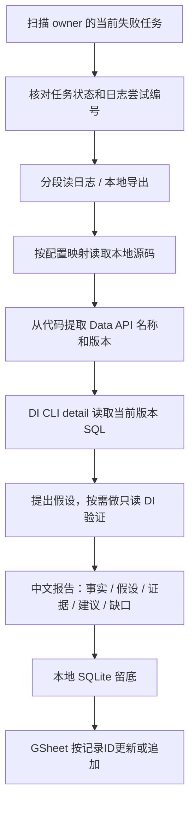

# 每日自动化排查：第一版

当前状态（2026-10-13）：用户修正凭据后，指定 Airflow 任务状态/日志/日期扫描已真实验证；服务账号已写入并读回 Sheet1 第 2 行，重复同步保持一行。这里只验收了指定任务和记录链，根因数据验证及完整网页 Agent 流程尚未验收。

## 使用

### 工具参数和失败留底

点回答下方的「任务详情」→「工具参数与结果」，可查看每次调用的 ID、参数（包括原 SQL）、开始/结束时间和返回结果。运行中、失败或中断的调用默认展开。「下载执行 Trace JSON」会导出本次输入、输出、工具调用、步骤事件、上下文统计、Skill 快照及恢复记录；行动说明是模型公开生成的说明，不是内部思考。

任务结束后自动保存到数据目录的 `run-traces/<runId>.json`（默认 `.data/run-traces/`）。Gateway 重启标记中断时也会保存。SQLite 是原始记录，JSON 写盘失败会记录错误，不改变任务结果；旧任务仍可从页面下载。文件权限为 600，过滤常见凭据字段与当前环境中配置的密钥，但仍包含内部 SQL 和业务日志，`.data/` 不提交 Git。

`RUN_TIMEOUT_MS` 是模型和工具共用的累计执行时间，审批等待不计入。DI CLI 最多等待 300 秒，Python 子进程等待 330 秒；包含 DI 的多步骤任务建议将 `.env` 的 `RUN_TIMEOUT_MS=600000`，修改后重启服务。总时限仍可能因多次慢查询耗尽。外层超时只代表未收到结果，不能据此判断远端 SQL 失败或安全重试。

2026-10-13 截图任务 `6d253704-c598-4343-8e16-c8d2fe639769`：总执行预算 120 秒，DI 调用约 89.7 秒时被 Gateway 中断；DataService detail 已成功。随后只读查询配置中的 DI 会话 7193633 返回 404，未获取这次 SQL 的最终状态，未重新提交查询。

重启网页后，在普通会话发送（不要在“商品成长”限定会话里使用）：

```text
/daily-check 检查 yara 在广告自动化服务器上 2026-10-08 到 2026-10-13 的失败任务。先给我名单，选一个继续排查。
```

### 每日自动扫描

服务启动后，每天北京时间 9 点后自动扫描一次 D-5～D0 的失败任务（只读，不排查、不写 GSheet），结果存在 `.data/daily-scan/<日期>.json` 和 `latest.json`。服务 9 点后才启动时会在启动时补扫；扫描失败 30 分钟后重试。打开“自动化看板”，顶部“每日失败扫描”列出名单，点“排查”会把 `/daily-check` 指令填进会话输入框，确认后发送。也可点“立即扫描”手动触发。代码见 `src/daily-scan.ts`，经 `airflow_cli airflow_scan_failures` 调用 Python 工具。服务没开着时不会扫描。

直接定位用户给出的失败实例：

```text
/daily-check 排查 automation 服务器的 dday_get_current_budget，运行 ID olivia.zhang2026-10-10-01-44-04，任务 dday_get_current_budget。读取日志，定位本地代码和实际 Data API SQL，区分已确认事实与假设，最后留底。
```

只读工具（Airflow、Data API 元数据、本地源码）自动批准；`di_query_sql` 和 `record_automation_check` 仍需网页批准。网页显示行动说明、参数、实际结果；行动说明是模型生成的简短理由，不是模型内部思考，也不代表操作已经执行。

## 调用链



统计、时间范围、分页、路径权限、记录去重由代码负责。模型负责从日志和查询结果选择下一项证据；本版不修改 SQL、源码、广告，不重跑任务。

## 文件职责

- `python/agent_backend/tools/airflow_scan.py`：分页读 `/dags` 取 owners 精确匹配的 DAG，再用一次 `dags/~/dagRuns/~/taskInstances?state=failed` 按任务 start_date 取全部失败实例，本地按 DAG 过滤。
- `python/agent_backend/tools/airflow.py`：原有读取工具，增加 owners/fileloc 和日志游标、可选本地导出。
- `python/agent_backend/tools/project_source.py`：只读 .py/.sql、路径映射、凭据遮盖、AST 提取 Data API；传入 traceback 的行号和代码时返回 line_match，用来发现本地与运行时版本不一致。
- `python/agent_backend/tools/dataservice.py`：CLI list/versions/detail 白名单；使用指定版本和副本；保留 SQL 摘要与 trace。
- `python/agent_backend/tools/check_records.py`：一个工具完成本地 SQLite upsert 和固定 GSheet 同步；同步失败返回 pending，相同参数再调用即重试。
- `python/agent_backend/tools/__init__.py`：统一 TOOLS 和工具元数据（risk、所属 Skill、审批标题、是否自动批准），TS 从 catalog 读取，不再手写工具名单。
- `skills/daily-check/SKILL.md`：排查顺序、证据标准和停止条件。
- `python/debug_agent.py`：复用真实 runtime，逐次人工批准所有 Python 工具，保留多轮历史。

## 配置

### Airflow

广告自动化使用独立配置，不借用 default 服务器账号：

```dotenv
AUTOMATION_AIRFLOW_BASE_URL=http://34.142.225.103:8080
AUTOMATION_AIRFLOW_USERNAME=
AUTOMATION_AIRFLOW_PASSWORD=
# 或 AUTOMATION_AIRFLOW_COOKIE=session=...
```

若同时配置 Bearer token，其优先级最高。账号密码先走 API 认证；API 拒绝时尝试 CSRF 网页登录。API 权限不足仍可能失败，登录网页成功不等于所有 API 都可访问。

### 源码映射

`config/source-roots.json` 已配置：

```text
/home/toc/SSE/yara/ -> /Users/yara.huang/yara/yara/
```

未映射的 Airflow DAG 配置文件路径不自动猜本地位置；需要添加确实存在的对应目录。哈希仅证明本地文件内容，不证明服务器版本相同。

### 事后记录

`config/check-records.json` 固定到用户指定表，tab 为 `Sheet1`。表头是 A1:P1：

记录ID、检查时间、服务器、DAG、运行ID、任务ID、映射编号、尝试编号、错误摘要、已确认事实、待验证假设、证据、处理建议、处理状态、覆盖情况、更新时间。

推荐本地设置（服务账号）：

```dotenv
CHECK_GSHEET_SERVICE_ACCOUNT_FILE=gsheet_email.json
CHECK_GSHEET_SERVICE_ACCOUNT_NAME=client_secret
```

服务账号必须能编辑目标表。标准单个服务账号 JSON 可直接读取；当前 gsheet_email.json 是包含三份命名字典的 Python 文本，用上述名称选择。通过 AST 字面量读取，不执行文件。google-auth 按 spreadsheets scope 获取令牌，过期时刷新；私钥不进入模型上下文或工具结果。服务账号认证使用 [Google 官方 Credentials 接口](https://google-auth.readthedocs.io/en/latest/reference/google.oauth2.service_account.html)。凭据文件已加入 .gitignore。

也兼容 CHECK_GSHEET_ACCESS_TOKEN / AUTOMATION_GSHEET_ACCESS_TOKEN 手动 token；显式服务账号配置优先。手动 token 必须有表格写权限，仍不自动刷新。Codex 的 Google Drive 连接不自动传给本地 Agent。

record_automation_check 先写 `.data/automation-checks.sqlite`，再同步 GSheet。相同服务器、DAG、运行、任务、map_index、尝试编号产生相同记录ID。复查更新事实与建议，保留首次检查时间。

每次同步先核对表头，再查 A 列记录ID：已存在则更新该行，不存在才追加。append 超时后重试会先找到已写入的行并更新，不会重复新增。没有并发锁，假设同一时间只有一个排查在写。状态和留底不是规则输入。

## 明确限制

- 扫描通常 4–6 个请求（DAG 列表 3 页 + 失败实例 1–2 页）；任何请求失败整个工具报错，不返回部分结果。
- 日期最多 31 个自然日；默认 IANA 时区 Asia/Shanghai。D-5 至 D0 是六日，按任务实例 start_date 纳入（包括手动运行），另外返回 execution_date。
- 已重试成功的实例不算当前失败，不提供所有历史尝试的失败统计。
- 日志默认末尾 12000 字符；可分段，导出限制 2 MB。日志文件是本次返回快照，非持续追踪。
- 一次聚焦一个失败任务、最多三次额外 DI 验证；daily-check 最多 12 轮工具请求后终止，Responses 仍限制总工具调用数。
- 当前版本 SQL 不等于失败当天 SQL；LIVE 非草稿副本不等于 serving 状态（实际返回可能 PRE_RELEASE）。
- 本地源码不等于线上代码；代码/版本缺失、权限失败应成为报告里的明确缺口。
- 不从预览行数推断全量数据；成功空结果、认证/连接失败、字段缺失分别报告。
- GSheet 写入只支持固定表和表头。认证未配置或同步失败，记录保留为 pending，不宣称已写云端。

## IDE 调试

VS Code / Cursor 以项目目录为根，选“Python：逐步学习 Agent”按 F5。QUESTION 留空时自己输入问题；DEBUG_SKILL 默认 daily-check。每个工具都会展示参数并询问 y。APPROVE_DI_QUERY=None 表示 DI 也逐次询问。原 SQL 示例保留在 DI_QUESTION。

断点：runtime.run 的 request；middleware.awrap_tool_call 的 call；具体工具函数；DebugGateway.last_tool_arguments / last_tool_result。不会将 Airflow 参数强行加 topic_id，也不会用 DI schema 校验 Airflow。

## 测试与真实验收

```bash
cd python
../.venv-di/bin/python -m unittest discover -s tests -p 'test_daily_check.py' -v
```

```bash
npm run build
node --test tests/daily-check.test.mjs tests/langchain.test.mjs tests/python-tools.test.mjs tests/skills.test.mjs
```

合成测试验证 owner 过滤/分页/日期换算/单 DAG/接口报错、受限源码读取和 line_match、Data API 白名单、只读工具自动批准、记录去重、append 后超时重试、表头冲突，以及 10-10 dday_get_current_budget 的回归样例。

真实验收需要：目标 Airflow 的认证；GSheet 写权限；用户允许将业务证据传给配置的模型服务商。模拟模型、接口测试和构建不等于整条生产链路通过。

### 2026-10-13 首次验证（凭据更新前）

- Node 全量回归 151/151 通过，包含真实 TS 桥接 → Python ToolNode → 模拟 Airflow 的批准/拒绝检查。
- 相关 Python 专项 64/64 通过，日常排查覆盖分页、日期、局部失败、源码只读、Data API 读取、本地与远端去重、append 后超时重试和 stdout JSON。
- 全量 Python 原有成长主题范围测试仍有 5 个失败断言：用户之前注释掉主题范围校验。未为让测试全绿而恢复限制。
- DI 的 list、versions、detail 已在用户指定 API/版本上真实读取成功。源码工具从实际本地文件第 115 行提取到相同 API 名称和版本；不代表服务器代码同版。
- 经用户明确授权，真实模型实际选择 dataservice_api_detail 并使用返回 SQL 回答。正确识别注释和生效日期条件、返回列与 PRE_RELEASE 状态；第一次回答对 >= D-2 的日期边界概括过度，已在工具注释与 Skill 补充限制说明。
- Airflow 第一次真实读取返回 401，等待用户完成独立服务器认证配置；未宣称线上链路已跑通。
- 记录表 Sheet1!A1:P1 已初始化并读回；尚未用本地应用凭据写入真实诊断行。浏览器未登录 Google，未完成浏览器视觉验收；通过 CellData 确认灰色加粗表头、换行和冻结行。

### 同日凭据更新后的验收

- 用户修正 Airflow 密码后，指定 dday_get_current_budget 运行与第 1 次日志读取成功，日志包含 KeyError。
- 对该 DAG 的 2026-10-10 实际 start_date 范围扫描成功：2 个运行、2 个任务实例，2 个当前失败任务，complete=true、query_errors=[]。这只证明所选 DAG/日期的扫描，不代表所有 yara DAG 都已验收。
- 服务账号文件中的 client_secret 已真实获得目标表元数据读取权限，配置已接入本地应用；未使用 Codex 连接代替服务账号。
- 新增服务账号测试覆盖 JSON、命名字典、安全字面量解析、Google token URI、刷新、错误脱敏和手动 token 兼容。
- 相关 Python 测试 72/72 通过。
- 实际调用 record_automation_check 和 sync_automation_check，将指定失败任务的真实状态、KeyError 和 sql datas: 0 留底；Sheet1!A2:P2 读回一致。再次同步仍更新第 2 行，第 3 行保持空白，未新增重复行。
- 本次记录为待确认，明确未执行数据 SQL、未完成根因验证；不冒充完整 Agent 诊断。

Airflow 扫描接口参考固定 2.10.5 的 [REST API 定义](https://github.com/apache/airflow/blob/2.10.5/airflow/api_connexion/openapi/v1.yaml)，实际部署兼容性仍以真实读取验证为准。
