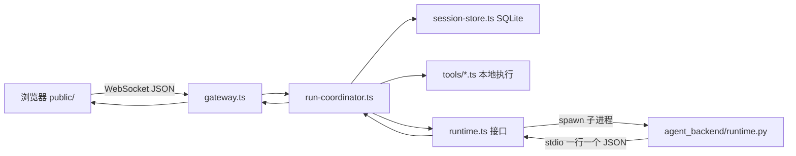

# `src/` TypeScript 架构 · Python 对照说明

仓库**线上跑的是 Node/TypeScript**（`src/` → `dist/`）。**模型与工具循环**在 **`python/agent_backend/runtime.py`**。  
若你看不懂 TS，可以按下面顺序用 **Python 阅读版**（`python/mirror_read/`）对照；完整索引见文末表格。

## 一张图：请求怎么走完

要点：

1. **Gateway** 只负责协议、限流、把方法分发给 **RunCoordinator**。
2. **RunCoordinator** 排队、超时、工具审批、拼上下文，再调用 **AgentRuntime.stream()**。
3. **LangChain 引擎**时，TS 的 `LangChainRuntime` **不自己在 Node 里调模型**，而是 `spawn python -m agent_backend.runtime`，用 stdin/stdout 传事件（见 `mirror_read/langchain_bridge.py` 注释版）。
4. **ads-rag**、**Hotpot 评测** 等仍在 TS，依赖 Node（SQLite、Transformers.js）；没有整包 Python 移植，见文末说明。

## 推荐阅读顺序（懂主链路即可）

1. `python/mirror_read/protocol.py` ↔ `src/protocol.ts`
2. `python/mirror_read/tool_policy.py` ↔ `src/tool-policy.ts`
3. `python/mirror_read/rate_limit.py` ↔ `src/rate-limit.ts`
4. `python/mirror_read/config_read.py` ↔ `src/config.ts`
5. `python/mirror_read/langchain_bridge.py` ↔ `src/providers/langchain.ts`
6. `python/agent_backend/runtime.py`（工具轮次、`tool_chars` / `total_calls` 在这里）
7. `src/run-coordinator.ts`（最长；用文档 + 调试 `pnpm debug` 跟一条 run）

## `src/` 文件索引（做什么 · Python 在哪）

| TypeScript 文件 | 作用（中文） | Python 对照 |
|-----------------|-------------|-------------|
| `server.ts` | HTTP 静态页 + WebSocket 挂 Gateway | 无完整移植；逻辑分散在 gateway + config |
| `gateway.ts` | WS：`connect` / `chat.send` / `tools.decide` 等 | `mirror_read` 仅协议；行为看 TS |
| `protocol.ts` | 校验 `{type:"req", id, method, params}` | `mirror_read/protocol.py` |
| `run-coordinator.ts` | 会话排队、执行 run、子 Agent、工具审批 | 无（太大）；核心在 TS |
| `session-store.ts` | SQLite 存会话、run、事件 | 无 |
| `runtime.ts` | `AgentRuntime` 接口 + 演示回声 | `mirror_read/runtime_demo.py` |
| `config.ts` | 读 `.env`，组装 runtime/tools | `mirror_read/config_read.py` |
| `rate-limit.ts` | 令牌桶限流 | `mirror_read/rate_limit.py` |
| `tool-policy.ts` | 工具风险：读/写/联网/执行 | `mirror_read/tool_policy.py` |
| `providers/langchain.ts` | 起 Python 子进程、转发事件 | `mirror_read/langchain_bridge.py` + `agent_backend/runtime.py` |
| `providers/chat-completions.ts` | 原生 OpenAI 兼容流式（可选） | 无 |
| `providers/responses.ts` | 原生 Responses API（可选） | 无 |
| `agents.ts` | 多 Agent / delegate 配置 | 无 |
| `skills.ts` | Skill 目录与刷新 | 无 |
| `tools/read-file.ts` | 工具注册表与 read/search 等 | 部分逻辑在 `python/di_export.py` 等 |
| `tools/di-export.ts` | DI 导出工具（TS 侧） | `python/agent_backend/di_tool.py` |
| `tools/airflow.ts` | Airflow REST | 无 |
| `tools/fetch-url.ts` 等 | 联网/研究工具 | 无 |
| `growth-topic.ts` | 商品成长主题 JSON | `python/growth_topic.py` |
| `ads-rag/*` | 广告语料 RAG（Node + ONNX） | 无；见 `docs/ads-rag.md` |
| `automation-dashboard.ts` | 自动化看板 API | 无 |
| `verification-*.ts` / `evaluation-*.ts` | 验收与评测读报告 | 无 |

## TypeScript 和 Python 语法对照（常遇到的）

| TypeScript | Python 大致等价 |
|------------|-----------------|
| `export function foo()` | `def foo():` 模块级函数 |
| `export class Foo` | `class Foo:` |
| `interface AgentRuntime` | `Protocol` 或 `class` + 类型注解 |
| `async *stream()` 异步生成器 | `async def stream()` + `yield` |
| `Promise<void>` | `asyncio` / `await` |
| `Map<string, T>` | `dict[str, T]` |
| `private readonly x` | 约定 `_x` 或 `@property` |
| `import ... from "./foo.js"` | `from .foo import ...` |
| `?.` 可选链 | `getattr(x, "a", None)` 或 `x and x.a` |
| `??` 空值合并 | `x if x is not None else y` 或 `or`（注意空字符串） |

## 若目标是「整个项目改成 Python」

当前设计是 **网关与工具在 TS、模型循环在 Python**。要全改 Python 需要重写：WebSocket 服务、SQLite 会话、全部 tools、ads-rag（换 Python embedding 栈），工作量和维护成本都很大。  
**建议**：先按上表用 `mirror_read` + `runtime.py` 读懂主链路；只有确定要弃用 Node 再立项全量迁移。
