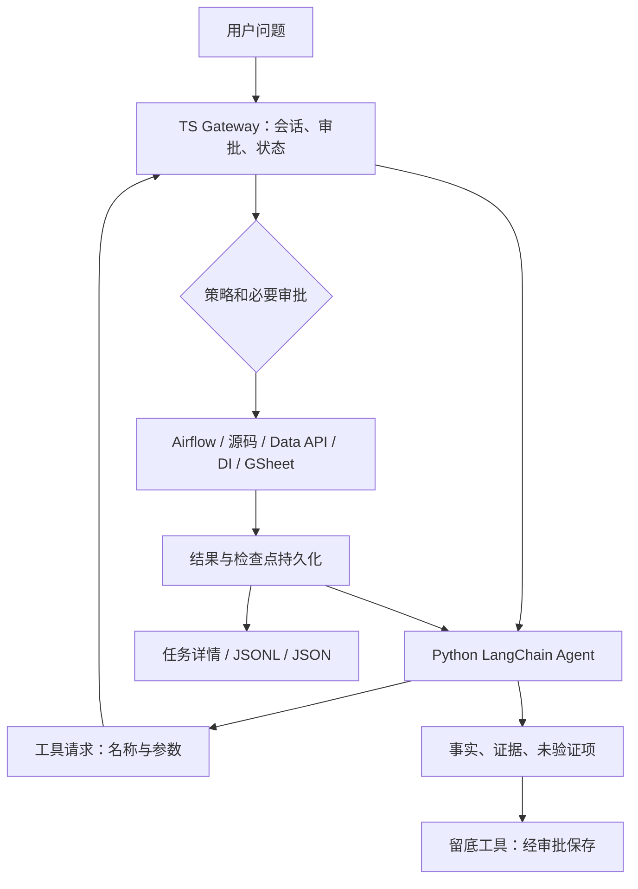

# 广告自动化排查与操作追溯 Agent

代码核对日期：2026-10-15。定位：本地单用户业务 Agent 原型；已接入部分真实服务，尚未完成生产部署与业务质量验收。

## 解决的问题

广告自动化的排查信息分散在任务调度日志、本地源码、Data API、业务表和 GSheet 中。排查者需要手工确定哪个任务失败、哪个变量的数据来自哪里、查询口径是否正确，以及应当如何记录证据。

本项目把这些读取能力注册为模型工具，在网页显示调用参数、结果和判断依据，并保留执行记录。重点验证两个问题：

- 自动化失败：任务失败在哪里，哪些结论已有证据，哪些只是待验证假设？
- 商品操作追溯：某个商品何时被哪个脚本做了什么，实际结果怎样？第二个场景正在建设来源映射，尚未端到端实现。

最小业务闭环是“提出问题 → 找数据来源 → 读取/查询 → 证据核对 → 人工确认 → 留底”，而不是自动调整广告账户。

## 已实现、可定位的工程能力

| 能力 | 当前证据 | 范围与限制 |
|---|---|---|
| RAG 意图路由 | [LangGraph 流程图](../python/agent_backend/intent_graph.py)、[Python MiniLM 召回](../python/agent_backend/intent_retrieval.py)、[调用入口](../python/agent_backend/router.py) | 模型选择检索或直接路由，ToolNode 检索、相关性评判、最多两次改写、Route 输出和节点 Trace；质量验证范围见意图路由文档，未做封存评测 |
| LangChain Agent | [runtime.py](../python/agent_backend/runtime.py)、[agent.py](../python/agent_backend/agent.py) | 使用 create_agent / ToolNode；模型仍可能选错工具、解释错结果 |
| 统一业务工具 | [注册入口](../python/agent_backend/tools/__init__.py)、[catalog](../python/agent_backend/catalog.py) | Python `@tool` schema 和风险元数据交给 TS，不在两端重复定义 |
| 跨系统读取 | Airflow 状态/日志、映射源码、Data API 定义、DI SQL/CSV、GSheet 表头和样例 | 需要相应权限；DataMap/DataHub CLI 已探索，但还没注册为 Agent 工具 |
| 审批和副作用边界 | [Coordinator](../src/run-coordinator.ts)、[DI 重试](../python/agent_backend/di_retry.py) | 写入需审批；DI 只重试指定状态读取，不自动重新提交 SQL |
| 执行轨迹 | [SessionStore](../src/session-store.ts)、[任务视图](../public/app.js) | SQLite 为原始记录；JSONL 实时追加、JSON 导出；包含参数和公开行动说明，不是模型内部思考 |
| 上下文与收尾 | [middleware](../python/agent_backend/middleware.py)、[额度配置](../config/tool-limits.json) | 字符预算、查询/留底分别计数；尚未按实际 token 和价格管理账单 |
| 会话与恢复 | [运行说明](../docs/long-running-agent.md) | 逐会话队列、终态、检查点；恢复主要覆盖研究和一层只读父子任务，不能推广为所有业务写操作可恢复 |
| Multi-Agent | [Agent 配置](../config/agents.json)、[派发实现](../src/agents.ts) | 一层只读父子派发、并发、取消、结果回传；现有角色为 reader/researcher，未完成广告业务角色协作 |
| 独立广告 RAG | [检索实现](../src/ads-rag/index.ts)、[本地模型](../src/ads-rag/model.ts) | MiniLM ONNX + BM25 + RRF、父子片段、来源与中文解释；独立 CLI，未接入主 Agent，无可信检索质量指标 |

Harness 在此指包围模型循环的执行控制：工具范围、审批、预算、错误回填、状态存储、恢复和评测。已有这些组成部分，不等同于完整生产 Harness。

RAG 和 `/team` 是现有独立能力；上图不表示它们已经并入业务排查。

## 一个能讲清技术判断的失败案例

使用合成日志可以复现以下问题，见 [评测输入](evaluation/cases.json)：

1. 业务代码访问 `log_df["操作时间"]` 报 KeyError。
2. 向前追溯发现 `log_df` 来自 GSheet，而不是附近打印的 SQL 查询。
3. 要核对实际站点对应的 tab、读取范围和表头；SQL 返回 0 行不能直接解释这个对象缺列。
4. 业务脚本打印异常后子进程仍退出 0；随后 Airflow 保存 XCom（任务返回值）时连接数据库失败。
5. 报告应分别说明业务缺列与调度持久化失败，不能仅按“哪个异常先出现”宣布唯一根因。

技术价值是正确选择验证路径并限制结论强度。新 Skill 已要求这种判断，但仍需真实模型批量评测，不能把写入提示词当成已经解决。

## 当前质量证据

下列为本次读取的历史报告，不是当前模型与代码的重新评测：

| 证据 | 已有结果 | 能说明什么 |
|---|---|---|
| 2026-09-30 HotpotQA 固定 10 题，旧研究路径 | 运行结束 7/10，答案与支持事实联合精确匹配 3/10 | 有受控问题和证据评分；质量尚不稳定 |
| 同批题，新研究路径 | 运行结束 9/10，联合精确匹配 2/10 | 更容易结束不等于更正确，不能以 90% 运行结束率宣称业务完成率 |
| 本地广告 RAG 索引清单 | 1202 父片段、4029 窗口、最长 122 tokens | 索引规模和输入边界；不证明召回正确 |
| 故障/审批/并发测试 | 现有测试和历史工程验收报告 | 验证程序行为，不作为业务正确率 |

原报告在本机 `.data/hotpotqa/gateway-paired-2026-09-30.json` 和 `.data/ads-rag/index.json`。公开说明只保留上述统计，不复制内部对话、账号、表数据和凭据。当前代码相对历史报告已有修改，不能混用版本宣称最新效果。

## 可直接使用的项目介绍

> 我在跨境电商自动化场景中开发了一个排查 Agent 原型，将 Airflow 日志、本地源码、Data API、只读 SQL 和 GSheet 纳入统一工具链。主循环使用 Python LangChain，TS Gateway 负责会话、审批和 SQLite 执行记录。我重点处理工具参数可观察、业务异常与工具异常区分、只读查询安全重试、上下文预算及人工审批。当前已完成部分真实服务联调；业务端到端质量和生产运维仍在验证。下一阶段重点是异构表语义映射和有标准答案的操作追溯评测。

只在本人确实理解并参与对应模块时使用“我设计/我实现”；AI 辅助生成的代码需要能独立解释、修改和排错。未达到的目标不写成既有成果。

## 演示与核对材料

1. 打开网页提出一个明确任务，查看本轮激活的 Skill、工具参数与返回值。
2. 演示一次模型沿错误数据来源查询的失败，展示日志/源码证据与修复策略。
3. 演示写入审批被拒绝时不执行、查询失败不被解释为“没有数据”。
4. 展示历史 HotpotQA 两版本对比，解释为什么没有把运行结束率当成功率。
5. 演示 RAG 独立入口，展示命中原文与出处，同时说明未接入主链路。

独立环境演示目前仍有配置门槛。这里新增的 12 个合成案例是开发集起点，不是可自动运行的 demo backend，也不是通过的模型评测结果。

继续阅读：[JD 缺口和补强顺序](../docs/portfolio-improvement-plan.md)、[评测方法](evaluation/README.md)。
